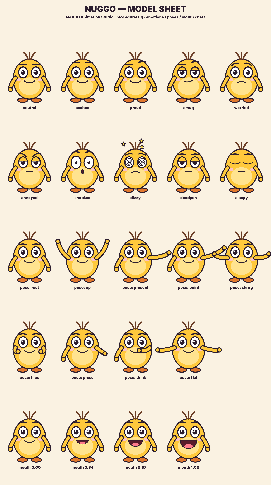
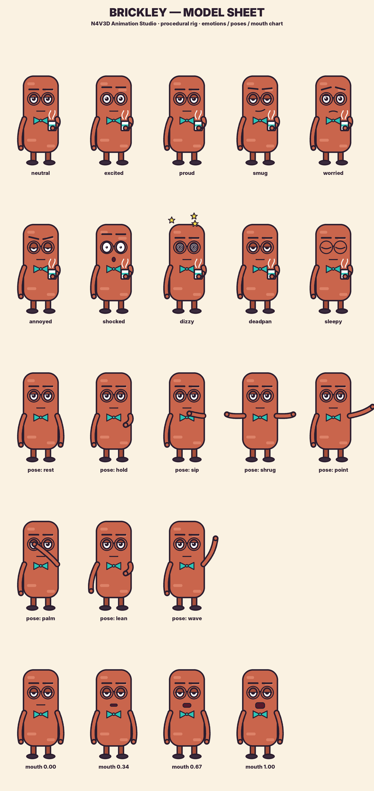
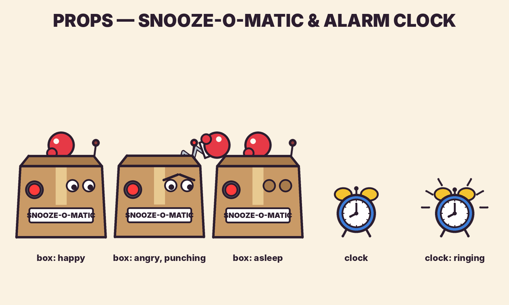

# Character Bible

Both characters are original designs, drawn entirely in code (`n4v3d/assets/characters.py`).
Model sheets: `assets/character_sheets/`. Regenerate them with `python -m n4v3d assets`.

---

## NUGGO

| | |
|---|---|
| **Shape** | Small, round mustard-yellow bean (#FFC93C). Three-strand brown hair tuft, big round eyes, pink cheeks, stubby arms, orange feet. |
| **Silhouette rule** | Always **round and low**. This is the opposite of Brickley. |
| **Personality** | Endlessly over-confident "life-hacker" and inventor. Takes huge swings and always declares victory, especially while visibly losing. |
| **Comedy engine** | The gap between his confidence and reality. He reframes every disaster as "phase one". |
| **Voice** | High, fast, bright. Placeholder: flite `slt`, pitch ×1.28, tempo ×1.12. |
| **Catchphrase seeds** | "Behold!", "Phase one… a total success.", "___ are for quitters!" |
| **Default emotion / pose** | `excited` / `rest`. Uses big poses: `up`, `present`, `point`, `hips`. |

## BRICKLEY

| | |
|---|---|
| **Shape** | A tall terracotta brick (#C9654C) with round glasses, heavy eyelids and a teal bow tie (#2EC4B6). Thin arms, short legs. |
| **Silhouette rule** | Always **tall and rectangular**. |
| **Personality** | Bone-dry, unbothered, quietly smarter than everyone. Always has tea. Never raises his voice. |
| **Comedy engine** | Deadpan understatement. His calm is the counterweight to Nuggo's chaos, and he gets the last word or the button. |
| **Voice** | Low, slow, flat. Placeholder: flite `rms`, pitch ×0.80, tempo ×0.90. |
| **Rules** | He barely moves. When chaos comes his way he *leans*; he never flinches. He sips at the funniest possible moment. |
| **Default emotion / pose** | `deadpan` / `hold` (mug). Uses small poses: `sip`, `hold`, `palm`, `shrug`. |

---

## Rig controls (both characters)

| Control | Values |
|---|---|
| `emotion` | neutral, excited, proud, smug, worried, annoyed, angry, shocked, dizzy, deadpan, sleepy |
| `pose` | per character: see `POSES` in `characters.py`; transitions blend automatically |
| `look` | pupil direction `[x, y]` in −1..1 (unflipped space) |
| `mouth` | driven automatically from the voice audio (4-shape lip-sync) |
| `blink`, breathing | automatic idle animation |
| `hold` | `"mug"` (Brickley) |

## Props

* **Snooze-O-Matic**: a cardboard box with googly eyes, a blinking antenna, a big red button and a spring-loaded boxing glove. Moods: happy, angry, sleepy, asleep. Punches can auto-aim at any entity (`"target": "nuggo"`).
* **Alarm clock**: blue twin-bell clock with a ringing state.

## Style guide
* One ink colour for every outline (#2B1D2E), 9 px at 1080p.
* Flat fills plus one highlight tone; no gradients on characters.
* Warm kitchen palette: cream walls, teal cabinets, peach checker floor.
* Comic bursts use yellow/white stars with red lettering.
