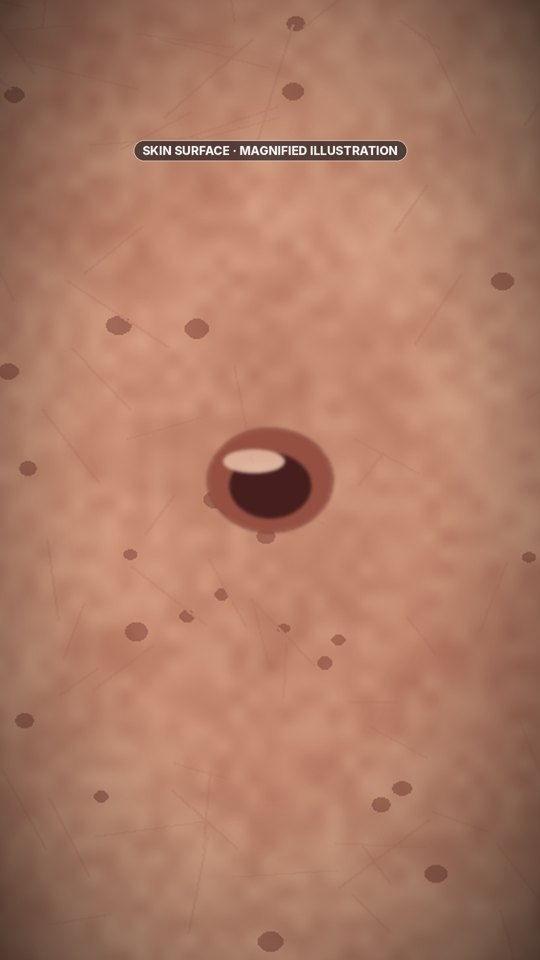
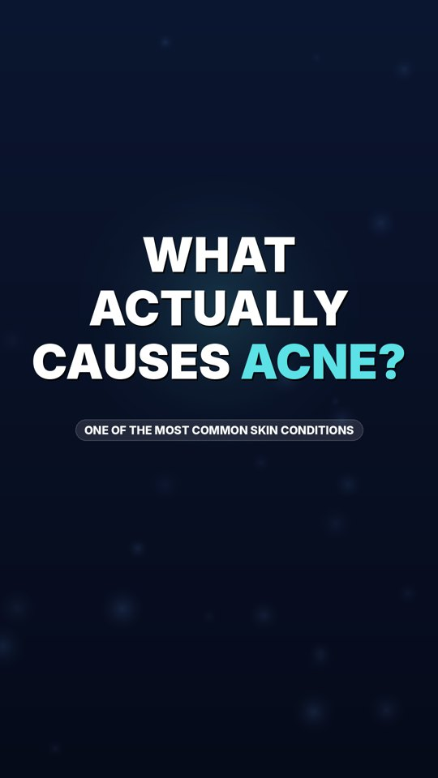
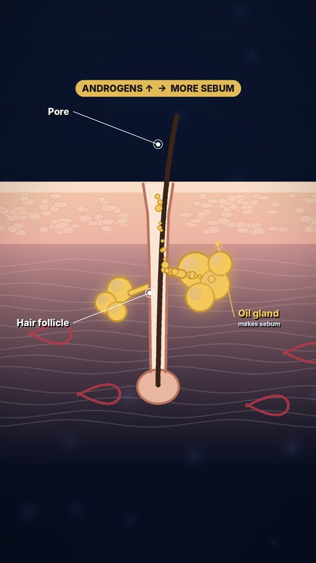
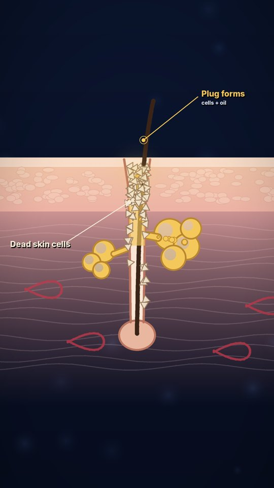
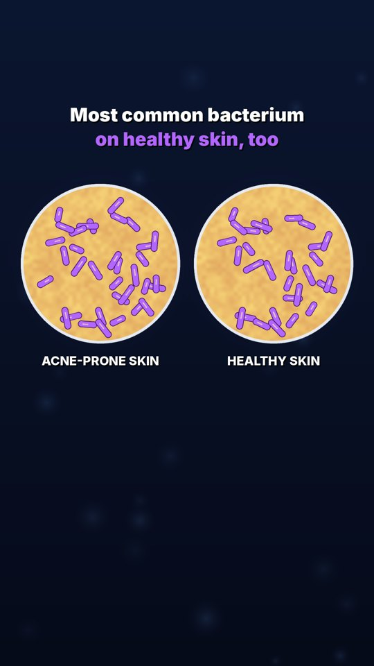
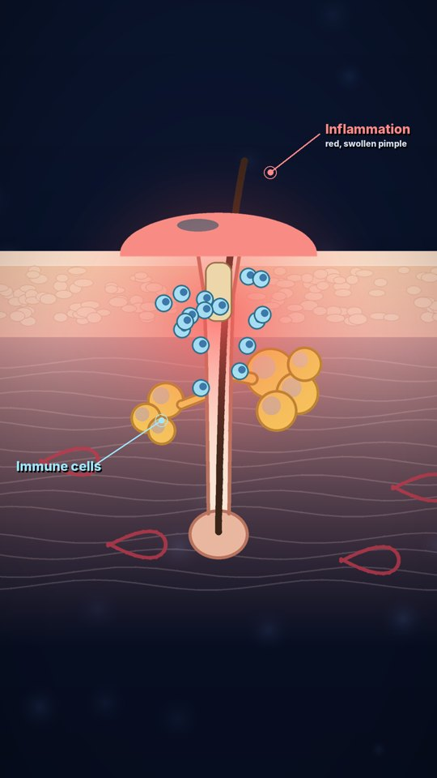
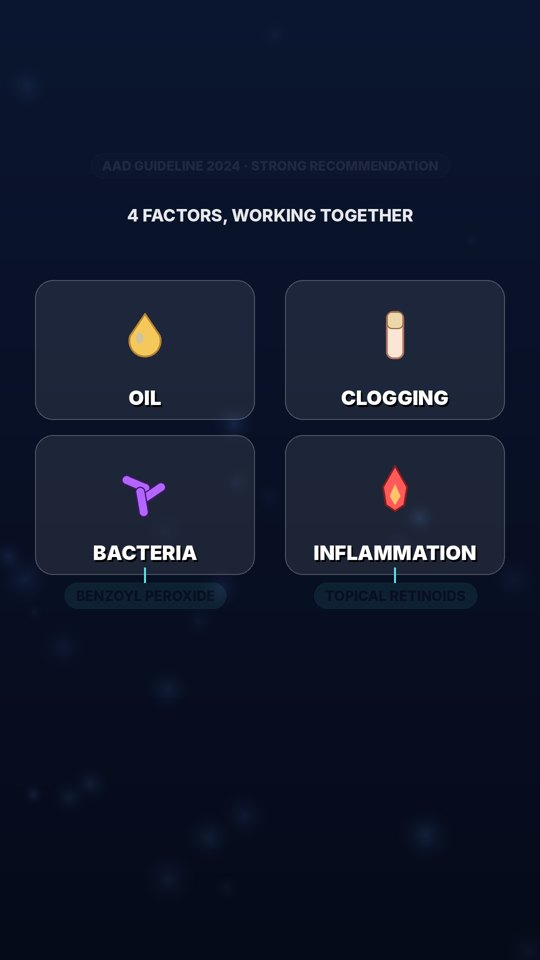
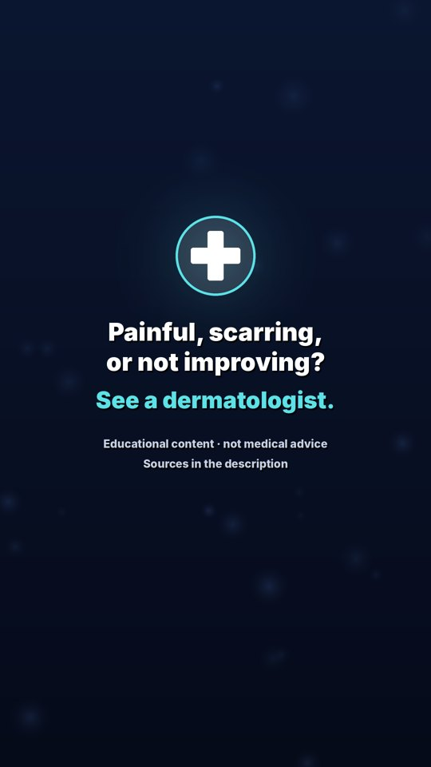

# Storyboard — What Actually Causes Acne?

Treatment: A calm, cinematic journey from the skin's surface into a single pore. Each step of acne formation is a new layer added to one consistent cross-section, so the viewer always knows where they are. Stylised scientific illustration, not gore: no close-ups of real lesions.

## 1. Hook · 0.0–3.9s · `pore_zoom`

**VO:** Every pimple begins in a place like this. A single pore.
**Claims:** C1

## 2. Question · 3.9–8.1s · `question_card`

**VO:** Acne is incredibly common. So what actually goes wrong in there?
**Claims:** C2

## 3. Discovery · 8.1–16.2s · `follicle_sebum`

**VO:** Each pore is a hair follicle with an oil gland. The gland makes sebum, and hormones called androgens can push it to make more.
**Claims:** C3, C4

## 4. Discovery · 16.2–24.3s · `plug_forms`

**VO:** Skin cells lining the follicle should shed and wash out. In acne, they pile up and stick together with the oil, forming a plug.
**Claims:** C5

## 5. Surprise · 24.3–33.5s · `bacteria`

**VO:** Inside that plug, a bacterium called Cutibacterium acnes thrives. The surprise? It's the most common bacterium on healthy skin too.
**Claims:** C6, C7

## 6. Surprise · 33.5–41.1s · `inflammation`

**VO:** The real trouble is your immune response. Inflammation is what turns a clogged pore into a red, swollen pimple.
**Claims:** C8

## 7. Payoff · 41.1–53.2s · `four_factors`

**VO:** So acne isn't caused by dirt. It's oil, clogging, bacteria and inflammation, together. That's why guidelines strongly recommend benzoyl peroxide and topical retinoids.
**Claims:** C9, C10, C11

## 8. Final · 53.2–59.6s · `health_end`

**VO:** And if your acne is painful, scarring, or not improving, a dermatologist can help.
**Claims:** C12
