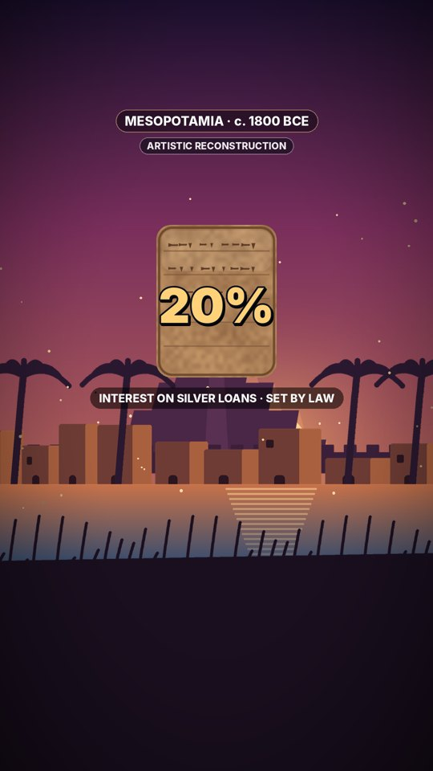
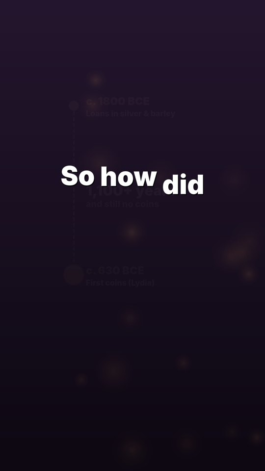
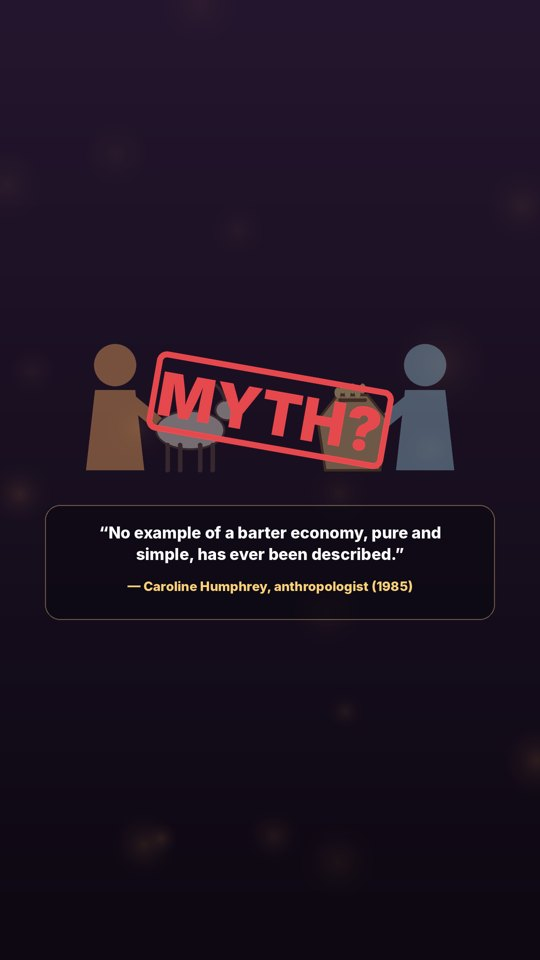
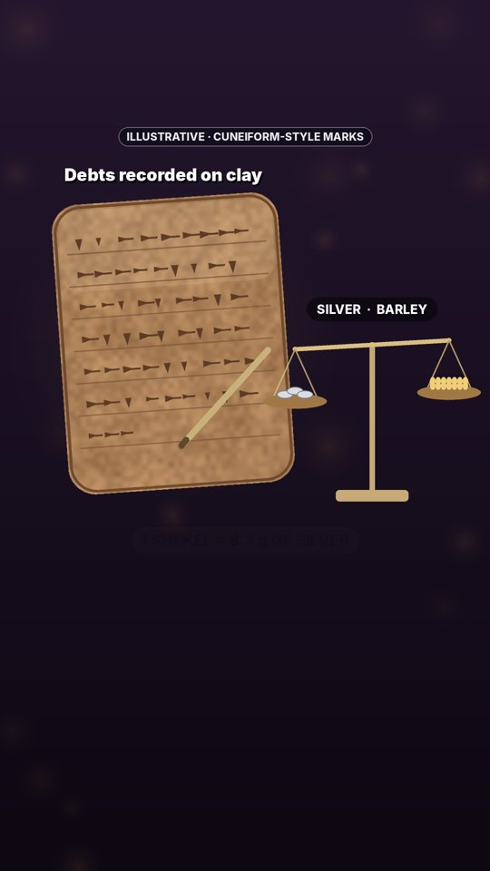
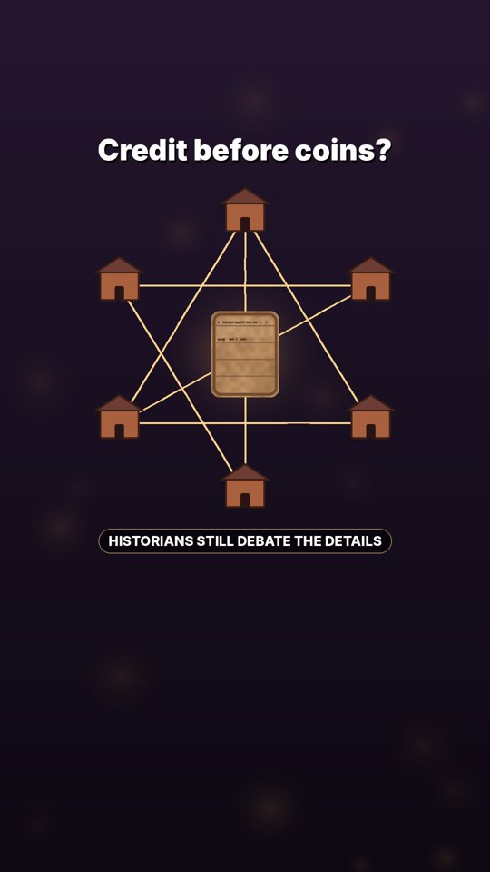
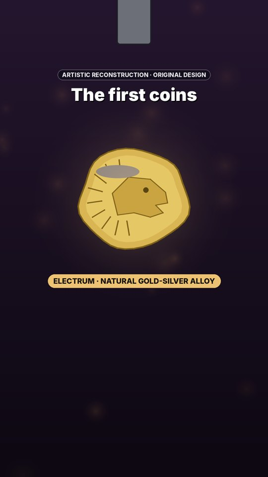
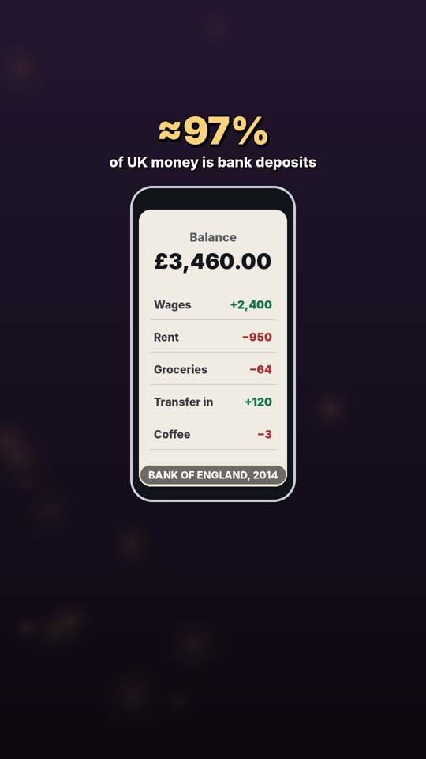

# Storyboard — How Did Humans Invent Money?

Treatment: A dusk-lit journey from a Mesopotamian city to a Lydian mint to a modern banking screen. The visual throughline is the ledger: clay tablet → coin → digital ledger. Every reconstruction is labelled; maps are simplified.

## 1. Hook · 0.0–6.2s · `mesopotamia_city`

**VO:** Nearly 4,000 years ago, Mesopotamians lent silver at 20 percent interest.
**Claims:** H1

## 2. Question · 6.2–11.6s · `no_coins_timeline`

**VO:** Yet the first coins wouldn't appear for over a thousand years. So how did money begin?
**Claims:** H2

## 3. Discovery · 11.6–20.7s · `barter_myth`

**VO:** The classic story says people bartered, a goat for some grain. But no one has ever documented a society that ran on barter alone.
**Claims:** H3

## 4. Discovery · 20.7–31.0s · `clay_ledger`

**VO:** Instead, Mesopotamian scribes recorded debts on clay tablets, measured in silver and barley. A shekel was a weight of silver, about eight grams.
**Claims:** H4

## 5. Surprise · 31.0–37.6s · `credit_web`

**VO:** So money may have started as a record of who owed what. Historians still debate the details.
**Claims:** H5

## 6. Payoff · 37.6–48.1s · `lydia_coin`

**VO:** Then, in the late six hundreds BCE, in Lydia, in modern Turkey, people stamped lumps of electrum, a natural gold and silver alloy. The first coins.
**Claims:** H6

## 7. Final · 48.1–57.4s · `modern_ledger`

**VO:** Today, the Bank of England estimates most money is bank deposits. Numbers in a ledger, a lot like a clay tablet.
**Claims:** H7
